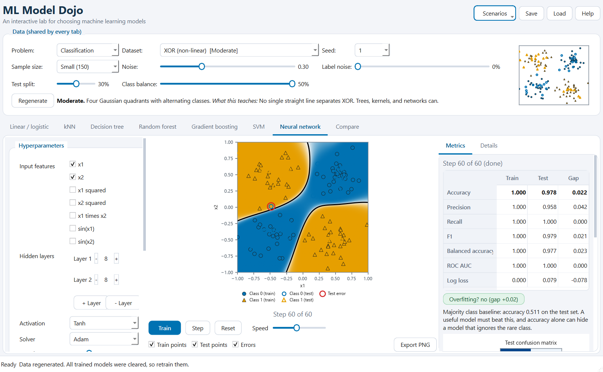
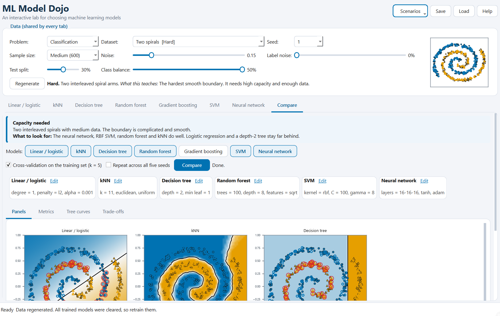
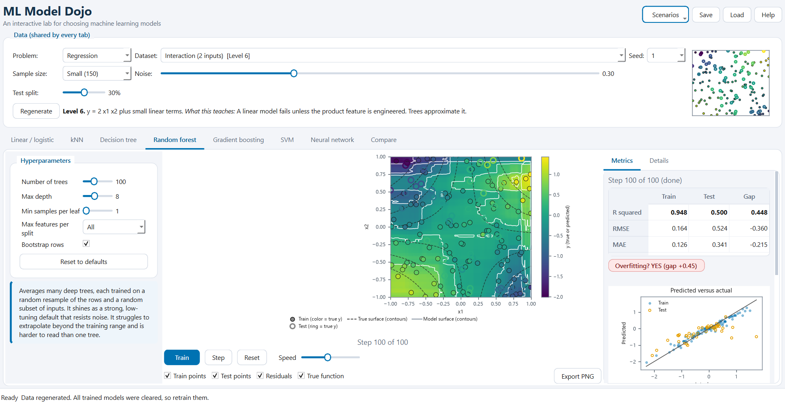
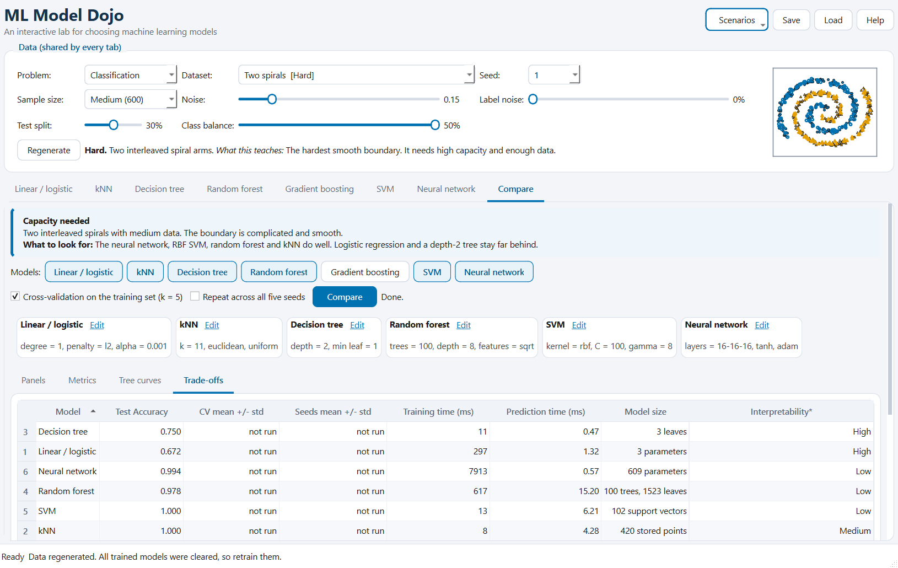

# ML Model Dojo

*An interactive lab for choosing machine learning models.*

> **Status: beta (version 0.9.0, work in progress).** The app is fully functional and tested, but it is still being polished, and some features are planned (see [Known limitations](#known-limitations-and-stretch-goals-not-reached)). Feedback and issues are welcome.



An interactive desktop tool, inspired by the TensorFlow Playground, that shows how different machine learning models behave on different kinds of data. It accompanies SIE 496/596 Smart Manufacturing Systems, Module 5-4 (model selection).

It is a native Python application (PySide6 and matplotlib). It has no web server, no browser interface and no network calls at runtime. All data are synthetic and generated from seeded random number generators.

## Screenshots

| Compare tab: decision boundaries side by side | Two-input regression with a color scale |
|---|---|
|  |  |

The Compare tab also has a metric chart, a table of results, and a trade-off table (test score, training and prediction time, model size, interpretability):




## What students can discover

1. A linear model cannot separate XOR, rings or spirals, but trees, kernel SVMs and neural networks can.
2. A very flexible model reaches 100 percent training accuracy on small noisy data and still does worse on test data.
3. More data shrinks the gap between training and test performance.
4. Accuracy misleads on imbalanced data. Precision, recall and F1 tell the real story.
5. Trees and forests cannot extrapolate. Linear models can, but they miss interactions unless you engineer a feature.
6. Bagging and boosting react differently to noise and to many trees.
7. A single run is weak evidence. Cross-validation and multiple seeds are more reliable.
8. The best model depends on training time, prediction time, model size and interpretability, not only on accuracy.

## Prerequisites

* Windows 10 or 11 (the code itself is cross-platform, only the launcher is a Windows batch file).
* Python 3.10 to 3.13 from <https://www.python.org/downloads/>. Tick "Add python.exe to PATH" during installation. The tool was developed and tested with Python 3.11. The launcher prefers 3.12, 3.11, 3.13 and 3.10, in that order, because every pinned package has wheels for them.
* An internet connection for the first run only (about 500 MB of packages).

## Run it by double-clicking

Double-click `run_ml_model_dojo.bat`. The first run:

1. finds Python 3.10 or newer,
2. creates a private virtual environment (the system Python is not touched),
3. installs the packages in `requirements.txt`,
4. checks that the packages import, and
5. opens the application without leaving a console window open.

Later runs only compare a hash of `requirements.txt`, so they start quickly and work offline. All installer output goes to `logs\setup.log`. If anything fails, the window stays open and shows the last lines of that log.

Where the environment lives: normally in `.venv` next to the launcher. Some Qt files have very long names, and Windows cannot unpack them when the project folder path is long (for example deep inside OneDrive). When the project path is longer than 80 characters, the launcher uses `%USERPROFILE%\.ml_model_dojo\venv` instead (not under AppData, because Microsoft Store Python silently redirects writes there). `run_tests.bat` applies the same rule.

## Run from a terminal

```bash
python -m venv .venv
.venv\Scripts\python -m pip install -r requirements.txt
set PYTHONPATH=src
.venv\Scripts\python -m ml_model_dojo
```

## Run the tests

Double-click `run_tests.bat`, or run:

```bash
.venv\Scripts\python -m pytest
```

The suite has three layers:

* **Fast tests** (about 3 minutes): seeding, every dataset generator, splits, every metric against hand-computed values, every model, and a GUI smoke test with `pytest-qt` in offscreen mode (choose XOR, train a tree, run Compare with two models, save and restore settings).
* **Model sweeps** (`tests/test_models_fuzz.py`, about 3 minutes): every data generator at every size and at extreme noise, balance and split settings, every hyperparameter of every model at its minimum, maximum, middle and every choice, and seeded random combinations of data and hyperparameters.
* **GUI sweeps** (`tests/test_gui_exhaustive.py`, about 35 minutes): every control on every tab clicked through its extremes, action sequences (train, pause, step, reset, change data or settings mid-training, cancel, export), every dataset on every tab, very large data, the Compare tab with every model and every option, all eleven scenarios with their follow-ups, Save and Load including damaged files, the Help window and tour, and several window sizes. Any error reported to the user, or any exception inside a Qt slot, fails the test.

Run only the fast tests with `python -m pytest -m "not slow"`. Exhaustive testing of every combination is impossible, so the sweeps cover each setting on its own plus many random combinations.

To recompute and rewrite the verified scenario numbers in `docs/scenarios.md`:

```bash
set PYTHONPATH=src
.venv\Scripts\python -m ml_model_dojo.scenarios.verify
```

## A quick tour

* The data panel at the top is shared by every tab. Changing the problem, dataset, size, noise, balance, split or seed regenerates the data and clears all trained models. Changing a hyperparameter only affects that model.
* Each model tab has hyperparameters on the left, the main plot in the center, and metrics on the right. Filled markers are training points, hollow markers are test points, and red rings are test errors.
* Press Train on any model tab (it becomes Pause while animating; F5 trains or pauses, F6 steps, F7 resets). Models without iterations (kNN, SVM, closed-form regression) train instantly, and then update live as you move sliders.
* The Compare tab trains the selected models in parallel on the same data and split. It reads each model's settings live from its own tab and marks a model Stale when its settings changed after the last run.
* The Scenarios menu loads one of eleven guided lessons.
* Save and Load store the full state in a small JSON file. The last used settings are also restored at startup.

## Animation strategy per model

| Model | How the animation works |
|---|---|
| Logistic regression | `SGDClassifier` with `partial_fit`, one epoch per step. Regression variants have a closed form and fit in one stage. |
| kNN, SVM | Single stage. |
| Decision tree | Fit once to find the leaf count, then refit with a growing `max_leaf_nodes` (best-first growth, one split per step). |
| Random forest | Fit once. Each step averages the first k trees. |
| Gradient boosting | Fit once with an evaluation set. Each step predicts with `iteration_range`. |
| Neural network | `partial_fit`, a few epochs per step. |

## How to add a dataset

Open `src/ml_model_dojo/data/datasets.py`.

* Classification: write a sampler `f(rng, label, n, noise) -> (n, 2) array` inside [-1, 1] that returns points of one class, then add `_c("my_id", "Name", "Description", "What it teaches", "Easy|Moderate|Hard", f)` to the list that builds `CLASSIFICATION`.
* Regression: write a noise-free function of `X`, then add `_r("my_id", "Name", "Description", "What it teaches", level, n_inputs, truth_fn)` to `_REG_LIST`. Pass a noise multiplier or a `post` function for special noise.

The dropdown, thumbnail and tests pick the new dataset up automatically, because the tests loop over the registries.

## How to add a model

1. Create `src/ml_model_dojo/models/my_model.py` with a `ModelSpec` subclass (parameters, concept card, summary) and a `Run` subclass (`_fit`, `_advance`, `predict`, `facts`, `extra`). Copy `knn.py` for a model with one stage, or `forest.py` for a model that replays stages.
2. Describe the controls in `_schema(problem)` as `ParamSpec` objects. The left panel, the save file and the Compare tab are all generated from them.
3. Register the spec in `models/registry.py`.
4. Add a details widget in `ui/details.py` if the model has something special to show.

## Design decisions

* One `Run` abstraction (fit once, then reveal stages) lets every tab, the Compare runner and the tests drive every model the same way.
* All randomness comes from `numpy.random.default_rng` seeded from the app seed with separate salts for data, split and models. Every estimator gets a `random_state`, and thread counts are fixed to one so results do not change between runs.
* The test set is split off first. Scalers and polynomial features are fitted on the training set only. Cross-validation in the Compare tab only uses the training set.
* Heavy fits run in a `QThreadPool`, and the Compare tab uses a persistent `ProcessPoolExecutor` with the Windows `spawn` start method. Jobs regenerate the dataset from `(config, seed)`, so no arrays are sent between processes, and results are cached by a hash of the job.
* Plots reuse artists, render a coarse 60 by 60 grid while animating, and refine to 160 by 160 when paused. Measured redraws take about 50 to 70 ms per frame at 600 and 3,000 points, which is above the 10 frames per second target, so pyqtgraph was not needed.
* Light theme everywhere, blue and orange class colors with different marker shapes, tooltips on every control, and visible keyboard focus.
* Errors are caught by a global handler. The traceback goes to `logs/app.log` and a dialog shows a short message while the application keeps running.

## Known limitations and stretch goals not reached

* The multi-class datasets (three blobs, pinwheel), the extra models (LDA, QDA, naive Bayes, AdaBoost) and the PyInstaller one-folder build (`build_exe.bat`) are stretch goals. `build_exe.bat` is included but was not tested.
* Each model type can be added to Compare once, so the contrast between two settings of the same model (for example logistic regression with degree 1 and degree 2) is done by editing the model tab and pressing Compare again. The Stale badge reminds you to do so.
* Timings are machine dependent. Interpretability ratings are a fixed guideline per model type, not a measurement.
* The SVM uses a Nystroem approximation above 3,000 training points, and shows a notice when it does.
* The launcher was tested on Windows 11 with Python 3.11. Other Python versions are untested.

## Contributing and license

Issues and pull requests are welcome. Please run the tests (`run_tests.bat`) before you open a pull request. The project is released under the [MIT license](LICENSE).

## Citation

If you use ML Model Dojo in teaching or research, please cite the GitHub repository.
